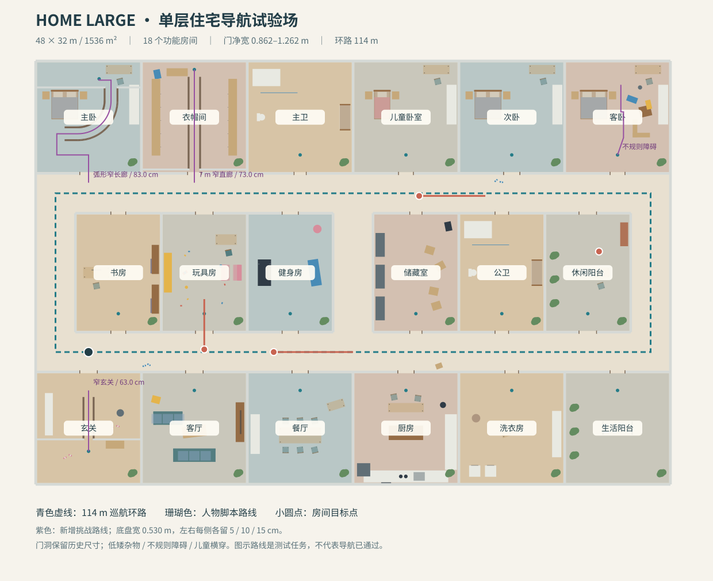

# home_large：大平层家居导航场景

48 × 32 m（1536 m²），单层、平地、无门槛；18 个功能房间、24 个带门框的门洞，净宽分为 0.862–1.262 m 五档。保留原 `home_indoor` 双层住宅与所有默认场景。



## 启动

在 `/home/alioth/nature_will` 执行：

```bash
source /opt/ros/jazzy/setup.bash
source install/setup.bash
colcon build --base-paths src --packages-select sentry_simulation --symlink-install
source install/setup.bash
./src/scripts/simlation.bash swerve home_large --check
./src/scripts/simlation.bash swerve home_large
# 无界面、无 RViz：
./src/scripts/simlation.bash swerve home_large --headless --no-rviz
```

链路沿用四舵轮 / 四 Odin → odin_multi_fusion → Omni MINCO。入口默认值、导航参数、控制和噪声保持原设置。`--check` 仅验证依赖和导航配置；不代表导航运行通过。

只查看平台与场景：

```bash
ros2 launch sentry_simulation swerve_odin.launch.py world:=home_large
```

所有模型使用本地几何，无 Fuel 下载。`ScriptedObstacle` 插件随 `sentry_simulation` 构建安装，新增后需重新构建。

## 门宽和房间

既有门洞保留历史 0.662 m 参考车宽，门框内缘距离为 **0.662 + 2 × 参考单侧余量**，净宽 0.862–1.262 m，净高 2.10 m、框体厚 0.24 m。下表的单侧余量均相对这个历史参考值。`manifest.json` 的旧字段 `robot_collision_width` 保留该门宽基准，当前平台尺寸另见 `robot_current_collision_envelope`；两者不能混用。

当前 `swerve_odin.yaml` 底盘为 0.730 × 0.530 m，Odin 碰撞外壳由 `swerve_platform.py` 安装至底盘外沿。四个车轮转向轴间距为 0.680 × 0.480 m，轮半径 0.065 m、接触宽 0.024 m。任意转向的轮胎扫掠直径为 `2 × hypot(0.065, 0.012)`；同时计入转向节后，整车的保守 XY 矩形包络为 **0.812197 × 0.612197 m**。这些是仿真几何尺寸，不是硬件实测。

| 单侧余量 | 门洞净宽 | 房间（中央房间南北门同档） | 门数 |
| --- | --- | --- | --- |
| 10 cm | 0.862 m | 主卫、储藏室 | 3 |
| 15 cm | 0.962 m | 洗衣房、衣帽间、公卫 | 4 |
| 20 cm | 1.062 m | 生活阳台、儿童卧室、客卧、书房 | 5 |
| 25 cm | 1.162 m | 餐厅、厨房、次卧、健身房 | 5 |
| 30 cm | 1.262 m | 玄关、客厅、主卧、玩具房、休闲阳台 | 7 |

- 南侧：玄关、客厅、餐厅、厨房、洗衣房、生活阳台。
- 北侧：主卧、衣帽间、主卫、儿童卧室、次卧、客卧。
- 中部：书房、玩具房、健身房、储藏室、公卫、休闲阳台。
- 走廊：南北两条 3 m 宽通道，两端连通形成环路；中央有横向连通的南北通道。

家具包括床、床头柜、衣柜、沙发、电视、橱柜、中岛、餐桌、高脚桌、不同朝向的椅子、洗衣机、浴缸、洗手台、晾衣架、书柜、纸箱、童车和盆栽。散落物包括 3 cm 鞋底的拖鞋、约 9–15 cm 积木、球、玩具车、低矮垫子。桌腿和悬空桌面分别建模；薄腿保留真实几何，地图栅格化时保守覆盖，避免消失。

`model.sdf` 中除了薄层地面饰面，每个静态物体都有对应的 visual 和 collision。人物模型也有头、躯干、手臂、腿和脚的独立碰撞体。几何为原创简化模型，适合导航障碍测试，不是照片级室内渲染。平屋顶覆盖整栋房屋及外墙边缘，尺寸为 48.2 × 32.2 × 0.2 m，底面 z=2.8 m 与墙顶对齐，顶面 z=3.0 m；屋顶 visual 完全透明（`transparency=1`）且不投射阴影，便于俯视室内，屋顶 collision 保留。所有可行走地面均在 z=0；室内布局可查看上方俯视图。

## 新增狭窄环境

新增通道的 **5–15 cm 指左右每一侧的余量，基准是 0.530 m 底盘宽度**。通道净宽为 `0.530 + 2 × 单侧余量`，三档分别为 0.630 / 0.730 / 0.830 m。每条窄通道都承担入口区与内部区域的唯一连接：横向隔墙接至原房间边墙，仅留下窄廊开口，长墙与隔墙真实重叠，不能从侧面绕到目标区。保留 18 个房间、原门洞尺寸、出生点和 114 m 环路；为形成有效连接，移动玄关鞋柜和衣帽间更衣凳，并将玄关、衣帽间、主卧三个目标点调整到通道另一侧。

| 挑战 | 位置 / 通道长度 | 净宽 | 左右每侧余量 |
| --- | --- | --- | --- |
| 窄玄关 | x=4，y=3.4–6.6；玄关入口区 → 内区；3.2 m | 0.630 m | 5 cm |
| 窄直廊 | x=12，y=23.8–30.8；北侧公共走廊 → 衣帽间更衣区；7 m | 0.730 m | 10 cm |
| 弧形窄长廊 | 主卧，半径 2.5 m 的 90° 弯道，加两端各 1 m 直道；约 5.93 m | 约 0.830 m | 15 cm |
| 不规则障碍 | 客卧中右部，x≈44–46.8、y≈26–30.2 | 随位置变化 | 不设恒定宽度 |

弧形中心为 (3.2,29)，弧线起点 (3.2,26.5)、终点 (5.7,29)。入口从西向东，出口向北，通过 y=30 隔墙的唯一开口进入主卧北侧书桌区。墙体以 2° 短盒拼接并重叠闭合接缝，实际径向净宽与标称值偏差小于 1 mm；校验同时考虑车头、车尾角点和出廊后横移。玄关隔断高 1.6 m、直廊高 2.0 m、弯廊高 1.7 m，封闭横隔墙高 2.8 m，厚度均为 0.14 m。每个障碍的渲染和碰撞几何一致，遵循 [Gazebo visual/collision 的职责](https://gazebosim.org/docs/harmonic/building_robot/#visual-and-collision)。

三个内部目标分别为：玄关 (4,2.5)、衣帽间 (12,31.35)、主卧书桌区 (4.8,30.65)。`challenges[].connects` 记录连接对象，`destination_bounds` 标出内部目标区。验收会在每条窄廊中间添加局部横切阻断，保持整栋房子的其他空间可用，确认出生点无法再到达该廊对应的整个目标区；原状则必须连通。

不规则障碍包含实心 L 形柜体、斜放包裹、阶梯状高低障碍、圆柱立柱。客卧参考路线会避开原有拖鞋，包含四舵轮可执行的横移段；路线坐标及 yaw（弧度）记录在 `manifest.json` 的 `challenges[].route`，紫色线显示在俯视图中。通道可从两端测试，必须使用正确车头朝向；本场景没有通过缩小车辆或放宽碰撞来制造可通行性。

0.05 m 静态栅格仍保守覆盖障碍；几厘米的真实余量会被栅格化进一步压缩。验收分别检查：完整转向包络在真实 SDF 几何中的连续运动，以及导航 footprint 在发布地图整块占据格上的连续运动。导航配置的 footprint 为 0.730 × 0.530 m，计入 [Nav2 Jazzy 默认每侧 0.01 m padding](https://github.com/ros-navigation/navigation2/blob/jazzy/nav2_costmap_2d/src/costmap_2d_ros.cpp) 后按 0.750 × 0.550 m 检查，包含车头、车尾及样本间运动；当前三条路线均通过。直廊与弧廊还通过 0.812197 × 0.612197 m 最大转向包络的保守 PGM 检查；63 cm 玄关属于极限档，不保证该最大包络在保守 PGM 中也通过。真实车体的姿态和在线地图仍需运行验证。

## 人物运动

三个人物默认运动：南走廊成人约 0.75 m/s、北走廊成人约 0.71 m/s、玩具房儿童约 0.42 m/s；另有休闲阳台站立成人。轨迹和速度由 `manifest.json` 的仿真时间路点定义，端点停留并转向后返回。

暂停全部人物（机器人和世界继续运行）：

```bash
gz topic -t /home_large/people/enabled -m gz.msgs.Boolean -p 'data: false'
```

恢复：

```bash
gz topic -t /home_large/people/enabled -m gz.msgs.Boolean -p 'data: true'
```

插件冻结轨迹相位，恢复从当前位置继续；Gazebo 暂停也会冻结轨迹。重载世界可复现初始人物位置。人物是不可推动的脚本碰撞代理：物理接触面随其位姿移动，但不模拟人体受力、步态动画、主动避让或真实推挤动力学。Gazebo 普通 Actor 无物理碰撞，因此本场景没有仅依赖 Actor 动画来代表可碰撞障碍。[官方说明](https://gazebosim.org/docs/harmonic/actors/)

## 地图和测试目标

- `maps/home_large.yaml/.pgm`：0.05 m 栅格，地图外边界为 unknown。对 z=0.005–0.40 m 的静态几何取保守投影，适用于当前低矮四舵轮；低障碍保留，高脚桌下方不填成实心箱体。更高机器人需重新确定地图投影高度。
- 所有人物均不烘焙到静态地图，依赖在线感知；静态地图不能代替实时三维碰撞检查。
- `manifest.json`：房间、门洞、人物及巡航路点；`challenges` 含障碍名称、净宽、`side_clearance`（相对 0.530 m 底盘的每侧余量）、`total_clearance`（两侧合计）和带 yaw 的参考路线。坐标单位 m，世界/地图原点一致。顶层 `door_clear_widths` 列出所有既有净宽档位；旧 `doors[].side_clearance` 仍相对历史门洞参考值。当前底盘宽读 `robot_current_collision_envelope.body_width`，最大转向包络宽读 `.width`。
- 出生点：(4, 10)，yaw=0。
- 114 m 环路：(4,10) → (46.5,10) → (46.5,22) → (1.5,22) → (1.5,10) → (4,10)。这是指定的多目标巡航任务；单次远目标可能选中央捷径。
- 连续过门可选择中央房间南门→房间内部→北门。门内外先对齐车头，分别测试正向和反向通行。

测试建议先暂停人物验证窄门与低障碍，再恢复人物验证横穿、临时阻挡和地图清除。几何连通性、世界加载、人物插件测试与完整闭环导航是不同证据等级，不保证当前导航参数一定能通过全部困难点。

## 重新生成

```bash
python3 src/simulation/sentry_simulation/resource/models/home_large/generate_scene.py
python3 -m pytest src/simulation/sentry_simulation/test/test_home_large.py -q
python3 -m pytest src/simulation/sentry_simulation/test/test_home_large_narrow.py -q
```

生成器依赖 Python、numpy 和 PyYAML。重复生成确定性地覆盖本场景的模型、世界、地图、manifest 和 SVG；历史门宽固定，当前包络按平台配置计算。已经运行的 Gazebo 不会热加载这些改动，下次加载 `home_large` 时生效。
